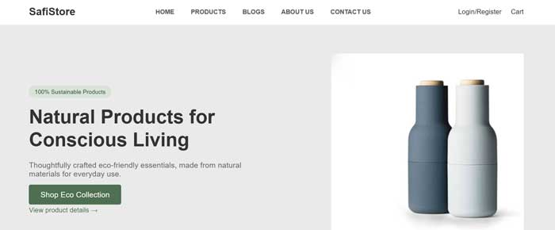
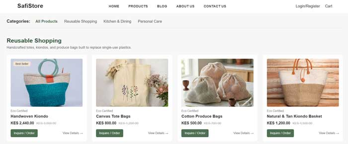
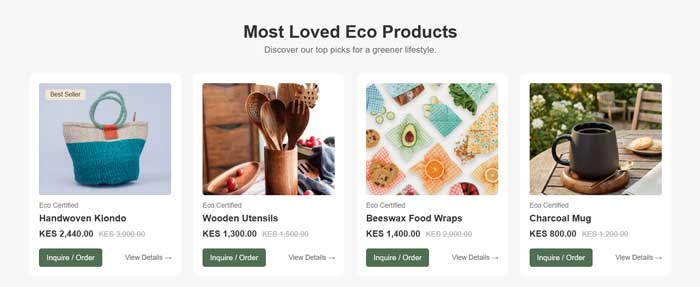

# SafiStore - Sustainable Living, Delivered to Your Door

SafiStore is a multi-page e-commerce website designed to showcase local, sustainable, and eco-friendly products across Kenya. Built with semantic HTML5 and clean CSS3, the platform offers a seamless browsing experience for conscious consumers seeking plastic-free alternatives for daily living.

---

## The Problem

Single-use plastics and non-biodegradable household goods contribute significantly to environmental degradation and waste in urban Kenya. While local artisans and eco-conscious vendors produce sustainable alternatives—such as handwoven kiondos, bamboo toothbrushes, beeswax wraps, and organic soaps—consumers often struggle to find a centralized, accessible digital marketplace to discover and order these goods directly.

## Target Audience

* **Eco-Conscious Consumers:** Individuals in Nairobi and across Kenya looking to reduce their environmental footprint by adopting plastic-free household, kitchen, and personal care products.
* **Local Kenyan Artisans & Vendors:** Eco-friendly craftsmen, weavers, and small businesses seeking an online marketplace to reach a wider customer base.
* **Everyday Shoppers:** Consumers seeking high-quality, durable, and locally crafted artisanal items with transparent pricing and convenient estate delivery options.

---

## Pages & Site Architecture

SafiStore is built using a clean multi-page structure where each page connects seamlessly via a global header navigation and footer:

* index.html (Home): Landing page showcasing key features, top eco-friendly products, customer reviews, and environmental impact metrics.

* products.html (Catalog): Main shop page displaying all products organized into key categories (Reusable Shopping, Kitchen & Dining, and Personal Care).

* Category Pages (reusable.html, kitchen&dining.html, personalcare.html): Dedicated category views to filter and browse specific product collections.

* Product Detail Pages (item1.html, etc.): Single product pages featuring an image gallery, vendor name, description, Nairobi estate delivery selector, and direct ordering.

* aboutus.html (About Us): Overview of SafiStore's eco-friendly mission and artisan community partners.

* contactus.html (Contact Us): Customer support info and inquiry form.

* login.html (Login): Account access page with a responsive split-screen design.

---

## Style Guide

* **Color Palette:**
  * **Primary Brand Green:** `#4f6f52` (Buttons, active navigation links, highlighted text)
  * **Dark Forest Green:** `#2e5339` (Section headings, badges)
  * **Soft Olive Accent:** `#d9e3d8` / `#dbe2d8` (Offer banners, badge backgrounds)
* **Typography:**
  * Primary Font Stack: `Arial, sans-serif`
  * Responsive font sizes using a combination of `px` baseline rules and custom inline/class overrides.
* **UI Components & Layout:**
  * **Flexbox:** Applied to header navigation, value banners, footer icon alignment, purchase actions, and offer cards.
  * **CSS Grid:** Used for 4-column product grids, 3-column testimonial layouts, and product image thumbnail galleries.
  * **Media Queries (`@media`):** Responsive layout adjustments for mobile screens (765px and below)
---

## Screenshots

* **Home Page:**  
  

* **Product Detail Page:**  
  

  * **Best Sellers:**  
  

---

## Live Demo

* **Live Site Link:** [View SafiStore Live on GitHub Pages](https://michaelmulwam.github.io/safistore/)

---

*Created as part of Web Development Coursework by Michael Mulwa — 2026.*